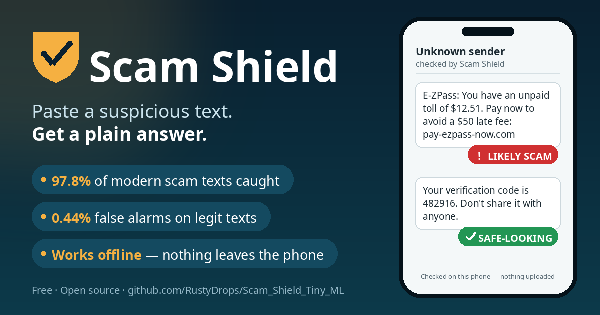

# Scam Shield — Tiny ML



A micro scam-text classifier for seniors: paste a text message, get a plain-language verdict — **SAFE-LOOKING / SUSPICIOUS / LIKELY SCAM** — plus the words that triggered it. It runs fully offline, on-device, in 0.31 MB. No message ever needs to leave the phone.

Built as part of a micro edge-model pilot: models small enough to train and run on modest hardware, trained only on public data, with full provenance.

## Try it

Open `demo/index.html` in any browser — one self-contained file (563 KB), no network calls, no build step. It runs the current v9 model. Paste a message or use the built-in examples:

- Bank impersonation example → 99.9% LIKELY SCAM
- Delivery-fee example → 99.8% LIKELY SCAM
- Legitimate family message → 0.8% SAFE-LOOKING

The demo's embedded model data (vocabularies, weights, threshold) is byte-identical to `model_v9.npz`, verified programmatically.

## The model (v9 — current)

TF-IDF (word 1–2 grams + character 3–5 grams) + logistic regression, group-balanced training, threshold chosen on a validation split by a fixed rule (maximise recall subject to false-positive rate ≤ 1%); test splits were evaluated once.

| Version | Modern (2025) smishing recall | Legacy spam recall | False alarms on legitimate | Size |
|---|---|---|---|---|
| v1 (2011-era data only) | 45.2% | 91.7% | 0.15% | 57,541 B |
| v2 (modern data, unbalanced) | 95.7% | 76.0% | 0.44% | 62,670 B |
| v3 (combined, balanced) | 97.4% | 94.8% | 0.29% | 310,698 B |
| v4 (+ 2026 scam families, de-masked data) | 97.7% | 94.8% | 0.29% | 315,715 B |
| v5 (+ transactional legit data) | 96.7% | 95.8% | 0.29% | 316,854 B |
| **v9 (v5 recipe + conversational scam data)** | **97.8%** | **97.9%** | **0.44%** | **317,338 B** |

Versions v6–v8 were built and rejected under pre-registered gates (documented in `PROVENANCE.md`); v5 remained the keeper until v9 passed all five of its gates. Full per-version detail: `metrics.json` … `metrics_v9.json`.

**v4 additions (2026):** trained on 46 seed templates covering 11 current scam families (unpaid toll/DMV, IRS refund, Amazon refund, task jobs, jury duty, fake FTC agent, recovery scams, and more), sourced from 17 FTC / FBI IC3 / IRS publications, expanded by deterministic code only — plus de-masked training data (real-looking links and numbers instead of placeholders). On a raw-form stress test, recall rose from v3's 93.3% to **96.3%**. Held-out 2026-family recall: **97.8%**.

**v5 fix (the important one):** v4 false-alarmed on **53%** of modern legitimate transactional texts — verification codes, appointment reminders, bank alerts — because its legitimate examples dated from 2011, before such texts existed. v5 adds code-generated transactional examples on both sides (a service *informing* you of a code = legitimate; a stranger *asking you to send* a code = scam). Transactional false-alarm rate: **0.35%**, transactional scam recall 100%, at a cost of ~1 point of modern recall (96.7%). Remaining weak spot: password-changed/security notices still tend to flag.

**v9 (conversational scams):** v8's fresh exam exposed a whole register neither model could read — conversational, emotional scams with few links or keywords. v9 changes **no recipe settings at all**; it only adds training data: romance and fake-grandparent ("emergency, don't tell Mum") scam families built the v4 way from public FTC/IC3 sources, plus matching legitimate chat-style messages so ordinary conversation doesn't start flagging. On template-disjoint test splits of those families, recall went from v5's **1.4%** to **97.1% (romance)** and **98.6% (grandparent)**. Fresh never-seen families (charity relief, package delivery): **94.3%** vs v5's 90.0%. Obfuscated-text recall: **93.5%** vs 92.0%. Raw-form stress recall: **95.6%** vs 94.6%. Transactional false alarms stayed at **0.35%** with 100% transactional scam recall. Known remaining gap: a lone "wrong number" opener ("Hi, is this Mark?") scores 0% for every version so far — by itself that message is genuinely ambiguous, and flagging it would mean false-alarming innocent wrong-number texts; the follow-up pitch is the detectable part.

## Honest limits

- Modern recall is optimistic: the 2025 dataset masks URLs and phone numbers with placeholders, unlike raw real-world texts.
- False-alarm rate is measured on 2011-era legitimate messages plus code-generated modern transactional/conversational examples, not seniors' real message inboxes — that is the key unmeasured risk.
- This is a prototype aid, not a guarantee. When in doubt, call the bank/company on the number on your card — never the number in the message.

## Data & provenance

Training data is public only, each source license-verified at source:

- **UCI SMS Spam Collection** (Almeida et al., 2011) — CC BY 4.0
- **IMC 2025 Smishing Dataset** (Agarwal et al., ACM IMC '25) — CC BY 4.0

No AI-model output (Claude/Muse, OpenAI, or otherwise) was used as training data, labels, scores, or filtering at any stage. Several candidate datasets were *excluded* on license or provenance grounds (including one that turned out to be LLM-generated) — the full record, including exclusions, is in `PROVENANCE.md`.

## Files

- `model_v9.npz` — the current v9 model (NumPy format); `predict_v9.py` — pure-NumPy inference (no sklearn needed at runtime)
- `train.py` … `train_v9.py` — training scripts; `gen_v4_data.py`, `augment_v4.py`, `seeds_v4.json` — 2026-family data generation; `gen_v5_data.py`, `probe_legit.py` — transactional data + the legit-probe that exposed v4's flaw; `gen_v9_data.py`, `seeds_v9.json` — conversational-scam data generation
- `model.npz`, `model_v2.npz`, `model_v3.npz`, `model_v4.npz`, `model_v5.npz` — earlier versions, kept for comparison; `model_head.onnx` — v1 ONNX head experiment
- `demo/index.html` — the offline browser demo (v9 model embedded); `demo/build_demo.py` — its builder
- `promo/scam-shield-promo-v3.png` — the card at the top of this README; `promo/build_promo.py` — its code-drawn builder (Pillow, no AI imagery)
- `PROVENANCE.md` — dataset licenses, exclusions, and per-version training record

## Run it (Python)

```bash
python3 predict_v9.py "Your bank account is locked, verify now at the link"
```

Datasets are not redistributed in this repo; the training scripts reference their public sources (see `PROVENANCE.md`).
